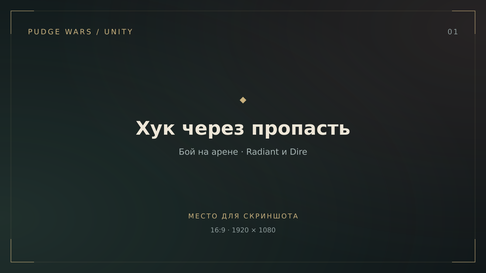
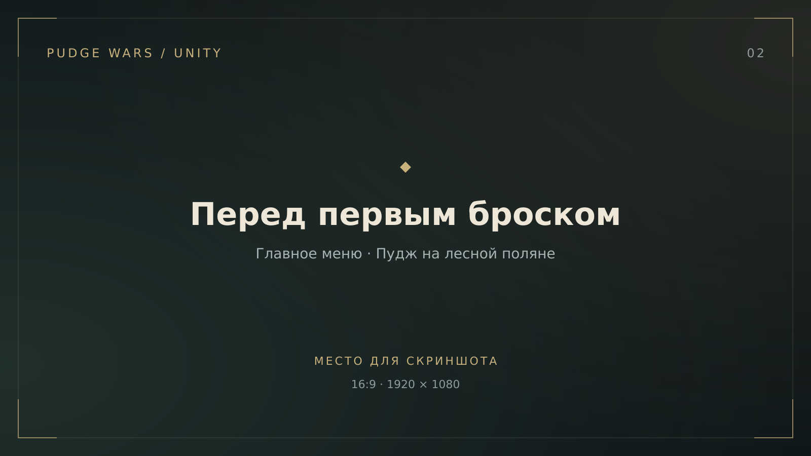
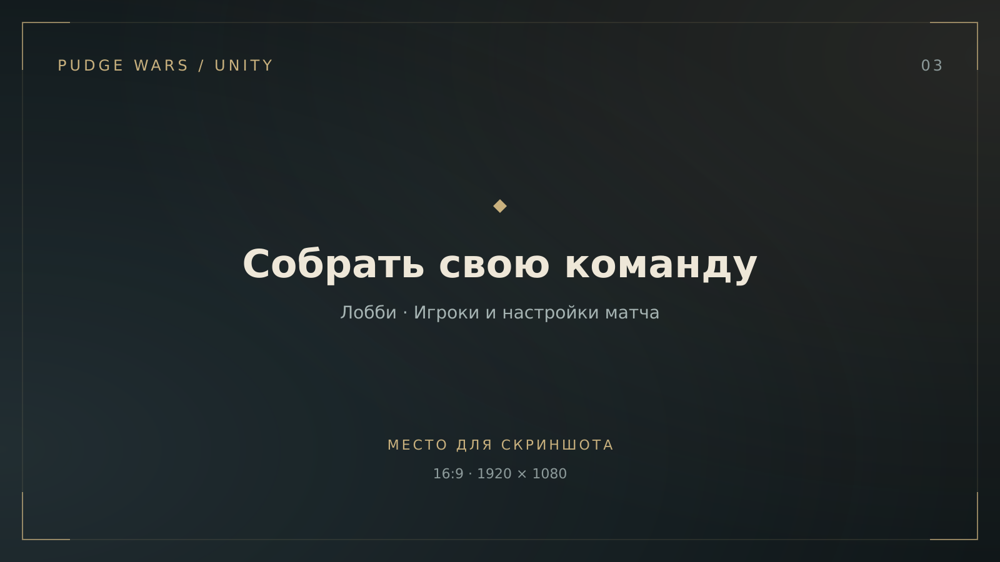
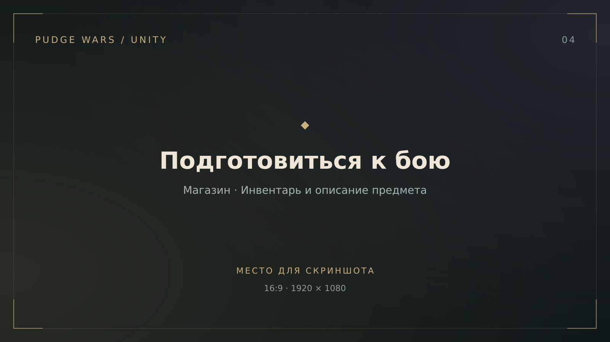
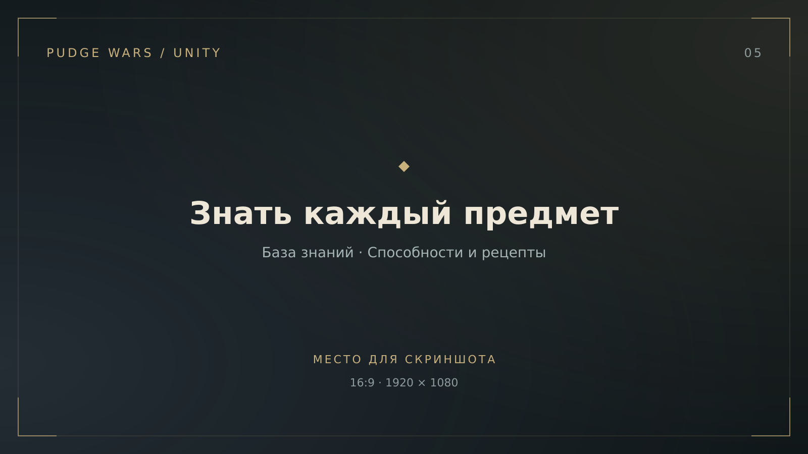

<div align="center">

# PUDGE WARS

**Две стороны. Одна пропасть. Всё решает хук.**

Перенос Pudge Wars на Unity — для ПК и Android, с ботами и мультиплеером.

**Unity 6** · **URP** · **Mirror + KCP** · **В разработке**

[Скриншоты](#скриншоты) · [Запуск](#запуск) · [Мультиплеер](#мультиплеер) · [Управление](#управление) · [Разработка](#разработка)

</div>

---



<p align="center"><em>Кадр для обложки: цепь пересекает яму, на крюке — противник, в кадре видны обе стороны арены и игровой HUD.</em></p>

## Об игре

Лови противников хуком, утаскивай их в пропасть и спасай союзников. Зарабатывай золото, собирай предметы и используй лес вокруг арены: деревья можно рубить, съедать и сажать заново.

Проект воссоздаёт мобильную **Pudge Wars от Ikrut** на Unity. Уже доступны матчи с ботами, лобби, поиск игр в локальной сети и подключение по IP. Подробное состояние реализации и история решений — в [PLAN.md](PLAN.md).

### Что уже есть

- **Хук с физикой боя.** Попадание, урон при протаскивании, спасение союзников и падение в яму. После гибели остаётся физическое тело, реагирующее на столкновения.
- **Командные матчи.** Radiant и Dire, выбор стороны в лобби, боты на свободных местах, счёт, таймер и объявления серий убийств.
- **Магазин и сборка предметов.** Компоненты автоматически собираются в готовые предметы; работают активные способности, ауры, восстановление здоровья и маны.
- **Боты с закупкой.** Целятся с упреждением, пытаются спасать союзников, собирают предметы и используют восстановление маны.
- **Живая арена.** Зелёная сторона Radiant, мрачная Dire, смена дня и ночи, падающие и отрастающие деревья. Лес главного меню генерируется заново при каждом открытии.
- **Три вида камеры.** Со своей стороны, со стороны противника и от первого лица. На ПК — мышь и клавиатура, на телефоне — сенсорные стики.
- **База знаний.** Герой, способности, предметы и рецепты: поиск, подробные описания и переходы между компонентами и улучшениями.

## Скриншоты

| Главное меню | Командное лобби |
| :---: | :---: |
|  |  |
| Пудж на поляне, лес и дорожки на фоне, панели меню по краям. | Подключённые игроки, составы команд и настройки перед стартом. |

| Магазин и предметы | База знаний |
| :---: | :---: |
|  |  |
| Открытый магазин, предметы в инвентаре и подробная подсказка. | Статья о предмете: иконка, способности, состав и улучшения. |

<details>
<summary><strong>Как подготовить и добавить скриншоты</strong></summary>

Снимай окно **Game** или готовую сборку без панелей редактора. Для единого вида подойдёт **1920 × 1080, 16:9**. Оставь HUD в кадре; перед снимком подсказки дождись, пока она полностью появится.

| Файл в `docs/screenshots/` | Что снять |
| --- | --- |
| `01-arena.png` | Бой у ямы с вытянутой цепью и пойманным героем. Камера сверху; желательно, чтобы были видны зелёная и тёмная стороны. Это главный кадр README. |
| `02-menu.png` | Главное меню до создания лобби: Пудж целиком, дорожка и деревья, читаемые панели интерфейса. Подойдёт любой из двух вариантов леса. |
| `03-lobby.png` | Лобби с двумя подключёнными игроками. Покажи названия команд, ники, заполнение ботами, сложность и кнопку «Начать игру». |
| `04-shop.png` | Матч с открытым магазином (`F4`). Купи несколько предметов и наведи курсор на Arcane Boots или Aether Lens, чтобы в кадре были инвентарь и развёрнутая подсказка. |
| `05-codex.png` | «База знаний» из главного меню. Открой Aether Lens или Arcane Boots: оставь видимыми список слева, описание, способности и ссылки на компоненты. |

Сохрани изображения под этими именами и замени в ссылках выше суффикс `-placeholder.svg` на `.png`. Подписи под кадрами можно оставить или обновить под получившиеся снимки. Заглушки после замены можно удалить.

</details>

## Запуск

1. Установи **Unity 6000.6.0f1** через Unity Hub. Для Android добавь модуль **Android Build Support** с SDK, NDK и OpenJDK.
2. Клонируй репозиторий и добавь его корневую папку в Unity Hub:

   ```bash
   git clone https://github.com/daniliammo/PudgeWars.git
   ```

3. Открой проект и дождись импорта ассетов и пакетов.
4. Открой `Assets/Scenes/Boot.unity` и нажми **Play** — после загрузки появится главное меню.
5. Укажи ник, выбери команду и включи ботов на свободных местах. Нажми **«Создать лобби» → «Начать игру»**.

Сцены уже сохранены в репозитории: для первого запуска пересобирать их не нужно. Порядок сцен в сборке: **Boot → Menu → Arena**.

Для сборки открой **File → Build Profiles**, выбери платформу ПК или Android и выполни **Build**. Настройка автоматических тестов и сборок описана в [руководстве CI](Tools/CI/README.md).

## Мультиплеер

Один игрок создаёт лобби; остальные подключаются из главного меню. Хост запускает матч, когда все собрались. До старта можно сменить сторону, если в другой команде есть место, — в том числе играть вместе против ботов.

| Режим | Как подключиться |
| --- | --- |
| С ботами | Создай лобби с ботами на свободных местах и запускай матч. |
| Локальная сеть | Подключи устройства к одной сети. Нажми **«В локальной сети»** и выбери найденную игру либо введи локальный IP хоста и нажми **«По адресу»**. |
| Интернет по IP | Введи доступный извне адрес сервера: `адрес` или `адрес:порт`. Стандартный порт — **7777/UDP**. Хосту за роутером нужен проброс UDP-порта; при CGNAT — доступный сервер или отдельное сетевое решение. |

Сервер рассчитывает движение, попадания, урон, покупки и счёт. Клиенты передают ввод и отображают состояние матча. Предсказание движения и компенсация задержки пока не реализованы.

## Управление

### ПК

| Действие | Клавиши |
| --- | --- |
| Движение относительно камеры | `W A S D` или стрелки |
| Выбрать хук и показать дальность | `Q` |
| Бросить выбранный хук | `ЛКМ` или `Пробел` — в сторону курсора; от первого лица — в прицел |
| Отменить выбор хука или предмета | `ПКМ` или `Esc` |
| Выбрать активный предмет | `Z X C V B N` или клик по слоту; затем укажи цель, если она нужна |
| Открыть / закрыть магазин | `F4` |
| Продать предмет за полцены | `ПКМ` по слоту инвентаря |
| Сменить вид камеры | `G` |
| Осмотреть героя или дерево | `ЛКМ`, когда способность и предмет не выбраны |
| Выбрать своего героя | `Пробел`, когда способность и предмет не выбраны |
| Открыть сетевое меню на арене | `F2` |

### Телефон

Левый стик двигает героя, правый задаёт направление хука. Отпусти правый стик, чтобы бросить хук; верни его в центр перед отпусканием, чтобы отменить бросок. Касание героя открывает его осмотр, касание слота выбирает предмет, удержание слота продаёт его. Вид камеры переключается экранной кнопкой; от первого лица поворот выполняется движением пальца по свободной области экрана.

## Разработка

| Часть проекта | Где искать |
| --- | --- |
| Игровые механики, хук, боты, камера и HUD | [`Assets/Scripts/Gameplay`](Assets/Scripts/Gameplay) |
| Предметы, инвентарь и магазин | [`Assets/Scripts/Gameplay/Items`](Assets/Scripts/Gameplay/Items) |
| Сеть, лобби и главное меню | [`Assets/Scripts/Net`](Assets/Scripts/Net) |
| Сборщики сцен и ландшафта | [`Assets/Editor`](Assets/Editor) |
| PlayMode-тесты | [`Assets/Tests/PlayMode`](Assets/Tests/PlayMode) |
| Проверка C# и сохранённого террейна | [`Tools/Check`](Tools/Check) |
| Подготовка моделей и текстур ландшафта | [`Tools/Landscape`](Tools/Landscape) |
| Извлечение исходных ассетов | [`Tools/AssetExtraction`](Tools/AssetExtraction/README.md) |

Стек: **Unity 6000.6.0f1**, **URP 17.6**, **Input System**, **uGUI / TextMesh Pro**, **Mirror 96.11.3**, **KCP**.

<details>
<summary><strong>Пересборка сцен и проверки</strong></summary>

Сцены собираются через меню редактора **Pudge Wars**:

| Команда | Результат |
| --- | --- |
| `Build Startup Scene` | Стартовая сцена `Boot` |
| `Build Main Menu` | Сцена главного меню `Menu` |
| `Build Test Arena` | Сцена `Arena`, включая ландшафт |
| `Build Landscape` | Ландшафт открытой арены с сохранением сцены |

**После изменения кода сборщика нужно выполнить соответствующую команду меню:** сам по себе новый код не обновляет сохранённую сцену. Для подготовки ландшафтных ассетов могут потребоваться внешние исходники; подробности — в [AGENTS.md](AGENTS.md) и [PLAN.md](PLAN.md).

PlayMode-тесты запускаются через **Window → General → Test Runner → PlayMode**. Они проверяют игровые механики, сеть, меню, ландшафт, базу знаний, загрузку и отрисовку интерфейса.

При закрытом редакторе их можно запустить из корня проекта в batchmode, указав путь к установленной Unity:

```bash
mkdir -p /tmp/pudgewars-tests
~/Unity/Hub/Editor/6000.6.0f1/Editor/Unity \
  -batchmode -projectPath "$PWD" \
  -runTests -testPlatform PlayMode \
  -testResults /tmp/pudgewars-tests/results.xml \
  -logFile /tmp/pudgewars-tests/unity.log
```

Для быстрой проверки C# без закрытия Unity нужны .NET SDK и сгенерированные редактором `.csproj`:

```bash
python3 Tools/Check/compile.py /tmp/pudgewars-compile
```

Эта команда проверяет компиляцию, но не запускает игру, GPU-проверки или Mirror Weaver. Настройка GitHub Actions и получение артефактов — в [Tools/CI/README.md](Tools/CI/README.md).

</details>

## Авторы и источники

Оригинальная **Pudge Wars** — **Ikrut**. **Pudge**, **Radiant**, **Dire** и используемые материалы **Dota 2** — **Valve**. В репозитории есть сторонние модели, текстуры, иконки и звуки; они не являются оригинальными ассетами этого проекта. Лицензия Mirror находится в [`Assets/Mirror/LICENSE`](Assets/Mirror/LICENSE).
